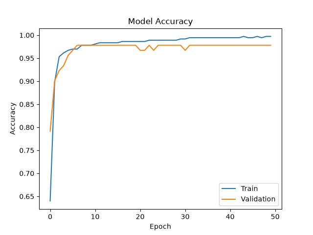
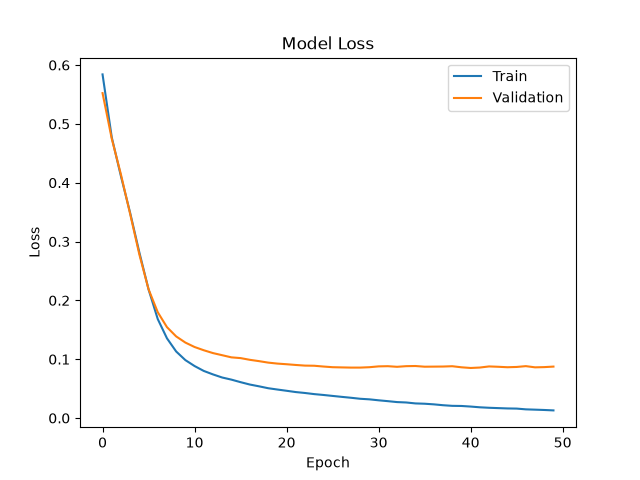
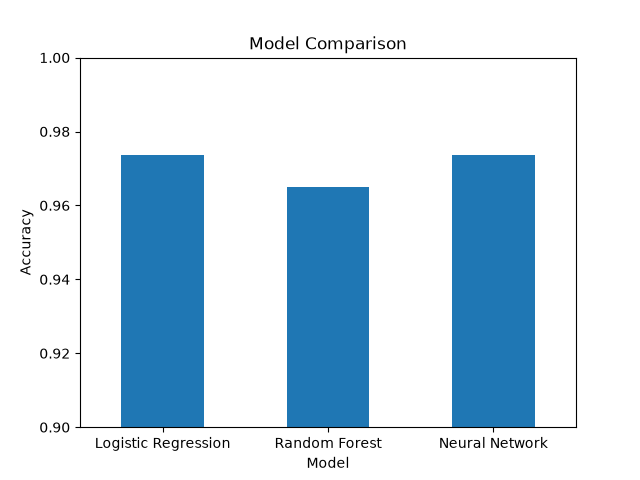

# 🤖 AI/ML Internship — Maincrafts Technology

**👤 Intern:** Ravindra Das &nbsp;|&nbsp; **🎯 Domain:** Artificial Intelligence & Machine Learning &nbsp;|&nbsp; **🏢 Company:** Maincrafts Technology

This repository contains my completed tasks for the AI/ML Internship program, covering regression on the **California Housing dataset** (Tasks 1-3) and classification / deep learning on the **Breast Cancer dataset** (Tasks 4-6).

## 🗺️ Overview

| # | Task | Dataset | Key Models / Topics | Folder |
|---|---|---|---|---|
| 1 | Linear Regression | California Housing | Linear Regression, MAE / RMSE / R² | [task1](./task1) |
| 2 | Feature Engineering & Comparison | California Housing | Ridge, Decision Tree, Scaling | [task2](./task2) |
| 3 | Validation & Tuning | California Housing | Cross-validation, GridSearchCV | [task3](./task3) |
| 4 | Classification & Imbalance | Breast Cancer | Logistic Regression, ROC-AUC | [task4](./task4) |
| 5 | Ensemble Learning | Breast Cancer | Random Forest, Gradient Boosting | [task5](./task5) |
| 6 | Deep Learning | Breast Cancer | Neural Network (Keras), Backpropagation | [task6](./task6) |

---

## 📁 Task 1 — Linear Regression Model (House Price Predictor)

**Goal:** Introduce the end-to-end ML workflow — data loading, EDA, preprocessing, training,
evaluation, and reporting.

**What was done:**
- Loaded the California Housing dataset and performed exploratory data analysis (distributions,
  correlations, missing values).
- Handled missing values and encoded categorical features.
- Trained a `LinearRegression` model with an 80/20 train-test split.
- Evaluated the model using MAE, RMSE, and R².
- Visualized results with Actual vs Predicted and residual plots.

**Results:** MAE ≈ $50,671 · RMSE ≈ $70,061 · R² ≈ 0.625

**Files:**
- [`task1_ml_linear_regression.ipynb`](./task1/task1_ml_linear_regression.ipynb) — full notebook
- [`Task1_ML_Report.pdf`](./task1/Task1_ML_Report.pdf) — 2-4 page report
- [`model.pkl`](./task1/model.pkl) — saved trained model

---

## 📁 Task 2 — Feature Engineering, Model Optimization & Performance Comparison

**Goal:** Go beyond a single model — apply feature scaling, train multiple algorithms, and select
the best-performing one using measurable metrics.

**What was done:**
- Applied `StandardScaler` for feature scaling.
- Trained and compared three models: Linear Regression, Ridge Regression, and Decision Tree Regressor.
- Evaluated all models on the same test set using MAE, RMSE, and R².
- Selected the best-performing model with justification.

**Model Comparison:**

| Model | MAE ($) | RMSE ($) | R² Score |
|---|---|---|---|
| **Ridge Regression** ✅ (best) | 50,668 | 70,057 | 0.6255 |
| Linear Regression | 50,671 | 70,061 | 0.6254 |
| Decision Tree (depth=5) | 50,341 | 71,511 | 0.6098 |

**Files:**
- [`AI_ML_Task2_Model_Comparison.ipynb`](./task2/AI_ML_Task2_Model_Comparison.ipynb) — full notebook
- [`Task2_ML_Report.pdf`](./task2/Task2_ML_Report.pdf) — 1-2 page report
- [`best_model.joblib`](./task2/best_model.joblib), [`scaler.joblib`](./task2/scaler.joblib) — saved best model + scaler

---

## 📁 Task 3 — Model Validation, Overfitting Control & Hyperparameter Tuning

**Goal:** Go deeper into professional ML practice — detect and control overfitting, validate models
reliably using cross-validation, and tune hyperparameters systematically with GridSearchCV.

**What was done:**
- Trained an unconstrained Decision Tree to demonstrate overfitting (train RMSE ≈ $0, test RMSE ≈ $69,790).
- Applied 5-fold cross-validation for a reliable, split-independent performance estimate.
- Used `GridSearchCV` to tune `max_depth` and `min_samples_split`, finding the best combination.
- Compared the tuned model against the Task-2 baselines (Linear Regression, Ridge Regression) and the untuned tree.
- Justified the final model choice using RMSE, R², overfitting gap, and cross-validation reliability.

**Model Comparison:**

| Model | Train RMSE | Test RMSE | Test R² | Overfit Gap |
|---|---|---|---|---|
| Linear Regression | 68,435 | 70,061 | 0.6254 | 1,627 |
| Ridge Regression | 68,434 | 70,057 | 0.6255 | 1,623 |
| Decision Tree (untuned) | ~0 | 69,790 | 0.629 | 69,790 |
| **Decision Tree (tuned)** ✅ (best) | 49,498 | 60,997 | 0.7161 | 11,499 |

**Files:**
- [`AI_ML_Task3_Model_Validation_Tuning.ipynb`](./task3/AI_ML_Task3_Model_Validation_Tuning.ipynb) — full notebook
- [`Task3_ML_Report.pdf`](./task3/Task3_ML_Report.pdf) — 2-3 page report
- [`best_tuned_model.joblib`](./task3/best_tuned_model.joblib), [`scaler.joblib`](./task3/scaler.joblib) — saved tuned model + scaler

---

## 📁 Task 4 — Classification Models, Evaluation Metrics & Handling Imbalanced Data

**Goal:** Move from regression to classification — build a binary classification system and evaluate
it properly with metrics beyond accuracy, handle class imbalance, and compare classifiers.

**What was done:**
- Built a binary classifier on the Breast Cancer Wisconsin dataset (Malignant vs Benign).
- Evaluated with confusion matrix, precision, recall, F1-score, and ROC-AUC.
- Explained why accuracy alone is misleading on imbalanced data.
- Tested class weighting (`class_weight="balanced"`) as an imbalance-handling technique.
- Compared Logistic Regression vs Decision Tree Classifier and justified the final model choice.

**Model Comparison:**

| Model | Accuracy | Precision | Recall | F1-Score |
|---|---|---|---|---|
| **Logistic Regression (baseline)** ✅ (best) | 0.9825 | 0.9861 | 0.9861 | 0.9861 |
| Logistic Regression (balanced) | 0.9561 | 0.9855 | 0.9444 | 0.9645 |
| Decision Tree | 0.9123 | 0.9559 | 0.9028 | 0.9286 |

ROC-AUC (baseline Logistic Regression): **0.995**

**Files:**
- [`AI_ML_Task4_Classification_Evaluation.ipynb`](./task4/AI_ML_Task4_Classification_Evaluation.ipynb) — full notebook
- [`Task4_ML_Report.pdf`](./task4/Task4_ML_Report.pdf) — 2-page report
- [`logistic_model.joblib`](./task4/logistic_model.joblib), [`logistic_balanced_model.joblib`](./task4/logistic_balanced_model.joblib), [`scaler.joblib`](./task4/scaler.joblib) — saved models

---

## 📁 Task 5 — Ensemble Learning, Model Optimization & Real-World ML Pipeline

**Goal:** Build a complete classification system with ensemble models and hyperparameter optimization, then select the final model with evidence.

**What was done:**
- Trained Logistic Regression (baseline), Random Forest and Gradient Boosting on the Breast Cancer dataset.
- Tuned Random Forest with `GridSearchCV` (best: `max_depth=5, n_estimators=100`).
- Compared models on accuracy, precision, recall, F1, ROC-AUC and 5-fold cross-validation (using the sklearn `Pipeline` API).
- Added feature importance visualization for model interpretation.
- Selected the final model on performance, stability and interpretability.

**Model Comparison:**

| Model | Accuracy | Precision | Recall | F1 | ROC-AUC | CV F1 (5-fold) |
|---|---|---|---|---|---|---|
| **Logistic Regression** ✅ (final) | 0.9825 | 0.9861 | 0.9861 | 0.9861 | 0.9954 | 0.985 |
| Random Forest | 0.9561 | 0.9589 | 0.9722 | 0.9655 | 0.9937 | 0.965 |
| Gradient Boosting | 0.9561 | 0.9467 | 0.9861 | 0.9660 | 0.9907 | 0.971 |
| Random Forest (tuned) | 0.9561 | 0.9589 | 0.9722 | 0.9655 | 0.9934 | 0.968 |

> [!TIP]
> **Key insight:** on this small, nearly linearly separable dataset, the simple baseline beat the ensembles — ensembles are benchmarked, not assumed better.

**Files:**
- [`AI_ML_Task5_Ensemble_Learning.ipynb`](./task5/AI_ML_Task5_Ensemble_Learning.ipynb) — full notebook
- [`Task5_ML_Report.pdf`](./task5/Task5_ML_Report.pdf) — 3-page report
- `final_logistic_model.joblib`, `best_rf_model.joblib`, `scaler.joblib` — saved models

---

## 📁 Task 6 — Deep Learning Fundamentals & Neural Network Implementation

**Goal:** Move into deep learning — understand Artificial Neural Networks (forward propagation, backpropagation), build and train a neural network with Keras, and compare it with the traditional ML models from earlier tasks.

**What was done:**
- Built a multi-layer dense neural network (Keras `Sequential`) on the Breast Cancer dataset: **30 → 16 (ReLU) → 8 (ReLU) → 1 (Sigmoid)**.
- Compiled with the Adam optimizer and binary cross-entropy loss; trained for 50 epochs (batch size 16, 20% validation split).
- Evaluated on the held-out test set and plotted training vs validation accuracy and loss curves.
- Compared the neural network against Logistic Regression (Task 4) and Random Forest (Task 5) on the same train/test split.

> [!NOTE]
> TensorFlow was blocked by Windows Application Control on my laptop, so Keras 3 was run with the **PyTorch backend**. The Keras code is identical.

**Test Loss:** 0.0736 · **Test Accuracy:** 0.9737

**Model Comparison:**

| Model | Accuracy |
|---|---|
| Logistic Regression | 0.9825 |
| Random Forest | 0.9561 |
| Neural Network (ANN) | 0.9737 |

> [!TIP]
> **Key insight:** the neural network reached 97.37% test accuracy, beating Random Forest (95.61%) but slightly behind Logistic Regression (98.25%). On a small tabular dataset, deep learning gives no clear advantage over simple models.

**Training Results:**

<table>
<tr>
<td align="center"><b>Accuracy</b> </td>
<td align="center"><b>Loss</b> </td>
<td align="center"><b>Model Comparison</b> </td>
</tr>
</table>

**Files:**
- [`Task6.ipynb`](./task6/Task6.ipynb) — full notebook with training output
- [`accuracy_graph.png`](./task6/accuracy_graph.png), [`loss_graph.png`](./task6/loss_graph.png) — training vs validation curves
- [`comparison.png`](./task6/comparison.png) — model comparison chart

---

## 🛠️ Tools & Technologies

Python · pandas · NumPy · scikit-learn · Keras (PyTorch backend) · matplotlib · seaborn · Jupyter Notebook

## 📊 Datasets

- [California Housing Dataset](https://scikit-learn.org/stable/datasets/real_world.html#california-housing-dataset) — Tasks 1-3: predicting median house value
- [Breast Cancer Wisconsin Dataset](https://scikit-learn.org/stable/modules/generated/sklearn.datasets.load_breast_cancer.html) — Tasks 4-6: binary classification (Malignant vs Benign)
